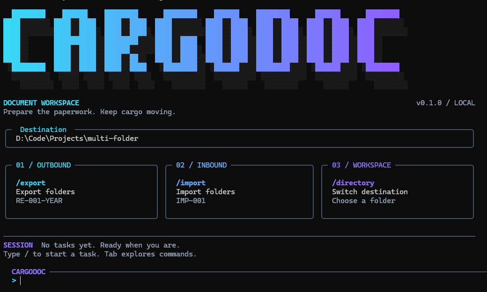

# CargoDoc

CargoDoc is a terminal workspace for preparing import and export folders for
freelance taxation work. Launch it with `cargodoc`, choose a task, and follow the
guided prompts. Runs locally; no account or AI service is required.



- Export folders: `RE-001-2026`, with a configurable year.
- Import folders: `IMP-001`, with zero padding based on your starting number.
- Interactive previews and confirmation, plus direct commands for scripts.
- Cyan-to-violet branding, command completion, and session history.

## Install on Windows

Requires Python 3.10 or newer and PowerShell. From the repository root, install
with [pipx](https://pipx.pypa.io/stable/installation/) to make `cargodoc`
available from any directory:

```powershell
python -m pip install --user pipx
python -m pipx install --editable .
python -m pipx ensurepath
```

Open a new terminal, navigate to an existing destination folder, and launch
CargoDoc. Replace the example path with your own:

```powershell
cd "D:\Clients\November"
cargodoc
```

No virtual environment activation is needed with pipx. The editable installation
uses this repository's source code, so Python code changes take effect when you
restart CargoDoc. Keep the repository in place. After moving it or changing
dependencies or package entry points, reinstall from the repository root:

```powershell
python -m pipx install --force --editable .
```

Verify your installation with `cargodoc --version`.

If the command is not recognized, run `python -m pipx ensurepath` and reopen
your terminal. For an IDE terminal, you may need to restart the IDE so it picks
up the updated PATH.

### Project-local alternative

For a local installation, use a virtual environment:

```powershell
python -m venv .venv
.\.venv\Scripts\python.exe -m pip install -e .
.\.venv\Scripts\cargodoc.exe
```

You can also activate it with `.\.venv\Scripts\Activate.ps1`, then use
`cargodoc` in that terminal. If PowerShell blocks activation, use the executable
path above.

## Interactive mode

```text
> /export
Starting number: 001
Ending number:   010
Year:            2026

Create these folders? [y/N]: y
```

The tool previews the destination, first and last folder names, and requested
count, then asks before creating folders. The year defaults to the current year.
Enter `y` or `yes` to confirm; `N` or Enter cancels. After each task it returns
to the prompt. The destination initially matches the directory from which you
launched CargoDoc; `/directory` changes it for the current session.

The workspace uses a cyan-to-violet pixel wordmark with layered shadows, mint
success states, and slate borders. A destination panel sits above three task
cards for outbound, inbound, and workspace actions. The banner scales down in
smaller windows and uses plain text in terminals without block character support.
At widths below 88 columns, the cards become a compact command list. The
command area includes completion and shortcut hints. `/clear` redraws the
workspace with the latest task from this session. Colors respect your terminal's
background; redirected output stays readable without color.

| Command | Action |
| --- | --- |
| `/export` | Create `RE-NUMBER-YEAR` folders |
| `/import` | Create `IMP-NUMBER` folders |
| `/directory` | Choose an existing destination directory for this session |
| `/help` | Show available commands |
| `/clear` | Redraw the welcome screen and latest session activity |
| `/exit` | Quit |

Tab completes commands; Up/Down recalls commands from this session. Ctrl+C
cancels the current prompt; Ctrl+D exits. Command history stays in memory.
The starting number determines zero padding: `001` produces three-digit names.

## Direct commands

Direct commands execute immediately, making them suitable for scripts. Use
`--dry-run` to preview without creating anything:

```powershell
cargodoc export --start 001 --end 010 --year 2026 --dry-run
cargodoc export --start 001 --end 010 --year 2026
cargodoc import --start 001 --end 020 --directory "D:\Clients\November"
cargodoc --help
cargodoc export --help
```

The destination defaults to the current working directory and must already
exist. Ranges are inclusive, contain digits only, and allow at most 100,000
folders per task. Existing directories are skipped; files with the same names
are reported as failures. The summary counts created, existing, and failed
folders separately. Interrupted runs may leave folders already created;
rerunning skips them.

Exit codes: `0` success (including skipped directories and previews), `1` folder
creation failures, `2` invalid arguments or destination, `130` interrupted direct
command. Interactive mode requires a terminal; direct commands also work when
output is redirected.

## Development

Install the package in editable mode before running it or its tests. The
`src/` layout keeps imports tied to the installed package:

```powershell
python -m venv .venv
.\.venv\Scripts\python.exe -m pip install -e .
.\.venv\Scripts\python.exe -m unittest discover -s tests -v
.\.venv\Scripts\python.exe -m cargodoc --help
```

```text
src/cargodoc/
  __init__.py
  __main__.py       # python -m cargodoc
  cli.py            # Direct command arguments and task dispatch
  interactive.py    # Persistent session and guided questions
  folders.py        # Folder validation and creation, independent of the UI
  ui/
    __init__.py
    theme.py        # Colors, prompt styles, and shared console
    banner.py       # Responsive CargoDoc wordmark
    views.py        # Welcome, prompts, help, previews, and results
tests/
  test_folders.py
  test_cli.py
  test_interactive.py
legacy/
  export/           # Original export script and PyInstaller spec
  import/           # Original import script and PyInstaller spec
```

The package uses `prompt_toolkit` for input and completion and Rich for output.
Build outputs, executables, virtual environments, and editor caches are ignored
by Git. Previously generated files in `EXP/` and `IMP/` may remain locally.

## Original standalone executables

The original scripts and PyInstaller specs are in `legacy/export` and
`legacy/import`. They run independently of CargoDoc, and the original export
script still uses its fixed 2026 suffix. To rebuild them with PyInstaller installed:

```powershell
cd legacy\export
pyinstaller export.spec
cd ..\import
pyinstaller import.spec
```

Outputs are `legacy\export\dist\export.exe` and
`legacy\import\dist\import.exe`.
